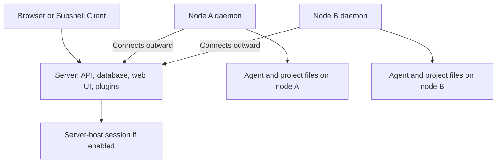
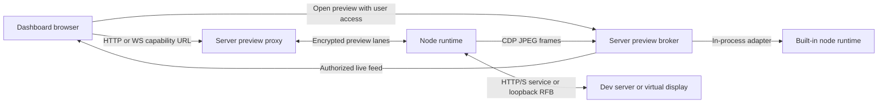

Understand the components that launch and display a Subshell session.

## How the components connect

Each node initiates its connection to the server. The server sends launch commands over that connection and relays terminal input and output. Your browser only needs to reach the server.

## Server

The control plane combines an API, SQLite database, and the web interface it serves. The standalone release embeds that web interface, so production needs one server process rather than a separate frontend deployment.

The server owns accounts, presets, plugin installation, sharing, and coordination metadata. It can launch agents on its own host if instance policy permits it.

## Nodes

An enrolled node runs the `subshell` daemon and connects outward to the control plane. It receives signed execution commands and streams pane output back.

The node executes under its OS account. Plugins remain on the control plane; launches carry resolved arguments and binary lookup rules rather than downloading a plugin set onto each node.

## Clients

A browser or Subshell Client displays the server's web interface. Subshell Server's desktop app also provides a native assistant for local installation, recovery, updates, and reset.

Browsers attach terminals through the control plane. They don't require a direct connection to each execution node.

## Agent communication

MCP runs beside the agent as a stdio child, using the pane's scoped identity. It seals channel bodies to recipient keys before sending them through the server.

The server relays ciphertext, but terminal output and channel metadata have different security properties.

## Web previews and virtual displays

Web previews & screens brings a subshell's dev server, browser frames, or virtual display into
the workspace. Your browser connects to the server; it doesn't need direct
network access to the node's ports.

The server checks subshell access and the node's separate web-preview or virtual-display permission before opening
a view. App forwarding and screen input need edit access. Watching browser
frames needs view access; view-only shares are restricted to the browser
discovered for their subshell.

The REST resource is `/api/subshells/:id/views`. Clients open a connection at
`/views/open` and start or stop browser watching at `/views/browser/watch`.
Node responses expose `webPreviewsEnabled` for web previews and `virtualDisplayEnabled` for virtual displays.
Node configuration uses `/views-enabled` with `feature: "web-previews"` or `feature: "display"`,
and display prerequisites use `/display-readiness`. The corresponding MCP tools
are `list_subshell_views`, `open_subshell_view`, and `watch_subshell_browser`.
See the [MCP tool reference](/mcp/tools#list_subshell_views) for their arguments.

For web previews, the server creates a private capability URL and forwards each
HTTP or WebSocket connection through a lane to loopback or the saved service destination on the execution
machine. Proxied documents have an opaque browser origin so website scripts
don't inherit dashboard authority. Target cookies stay in a server-side jar.
The server's built-in node uses the same discovery, forwarding, CDP, and display
runtime through an in-process adapter.

Browser watches use Chrome DevTools Protocol to emit JPEG frames. Virtual
displays use a shared provider interface for requirements, allocation, launch
settings, recovery, and cleanup. Node owners enable providers and choose a
default; each subshell can request an enabled provider and saves that choice
for restarts. Both the server and the node enforce the selection.

The only bundled provider today is **Xvfb + VNC** on Linux. It creates a private
Xvfb display and loopback x11vnc listener; a separate VNC viewer adapter renders
and controls the RFB stream with noVNC. Other providers can reuse that viewer
if they expose VNC. Providers are bundled with Subshell, rather than installed
through the harness-plugin manager. Local launch credentials stay on the node;
the server receives only the display identifier and viewer connection. These are separate from the agent's
terminal stream and from encrypted agent-to-agent channels. The trusted server
can read preview bytes and frames.

Each app port, browser watch, and display is a separate workspace tab with a
parent subshell. Desktop previews initially split to the right. The phone tab
strip leaves the desktop split layout unchanged. Saved layouts retain only
previews whose parent pane is still authorized and present.

See [Web previews & screens](/guides/preview), [Preview transport](/reference/node-protocol#preview-transport),
and [Preview security](/concepts/security#preview-security).

## See also

[MCP and agent communication](/mcp), [Access model](/concepts/access), and [Security model](/concepts/security).
