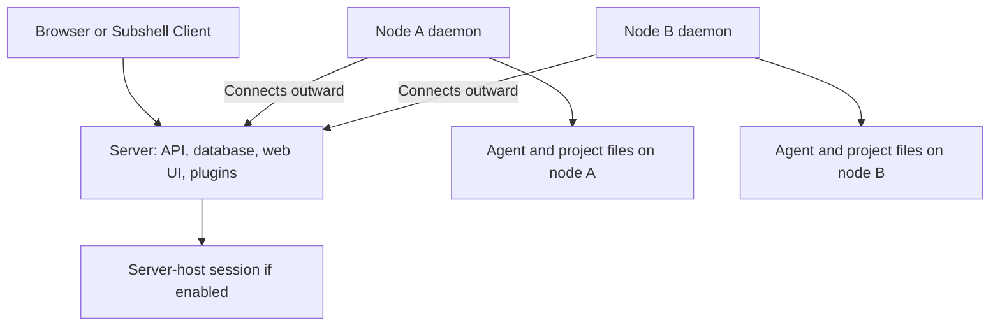

Understand the components that launch and display a Subshell session.

## How the components connect

Each node initiates its connection to the server. The server sends launch commands over that connection and relays terminal input and output. Your browser only needs to reach the server.

## Server

The control plane combines an API, SQLite database, and the web interface it serves. The standalone release embeds that web interface, so production needs one server process rather than a separate frontend deployment.

The server owns accounts, presets, plugin installation, sharing, and coordination metadata. It can launch agents on its own host if instance policy permits it.

## Nodes

An enrolled node runs the `subshell` daemon and connects outward to the control plane. It receives signed execution commands and streams pane output back.

The node executes under its OS account. Plugins remain on the control plane; launches carry resolved arguments and binary lookup rules rather than downloading a plugin set onto each node.

## Clients

A browser or Subshell Client displays the server's web interface. Subshell Server's desktop app also provides a native assistant for local installation, recovery, updates, and reset.

Browsers attach terminals through the control plane. They don't require a direct connection to each execution node.

## Agent communication

MCP runs beside the agent as a stdio child, using the pane's scoped identity. It seals channel bodies to recipient keys before sending them through the server.

The server relays ciphertext, but terminal output and channel metadata have different security properties.

## Web previews and virtual displays

Web previews bring a website running on a node into your workspace. A browser
watch shows live images from a browser on that node, while a virtual display
lets you control its graphical apps. All three connect through the server, so
your browser doesn't need direct network access to the node's ports.

The node owner enables web previews and virtual displays separately. Opening
a website or controlling a display requires edit access to the subshell.
View access lets you watch the browser discovered for that subshell.

Linux displays use Xvfb and x11vnc. macOS displays use BetterDisplay and the
Subshell Display Helper, which requires local consent and macOS permissions.
A macOS virtual screen shares the signed-in account's desktop, focus, and
pointer. Neither provider sandboxes the programs you run.

Preview websites are isolated from the dashboard's browser storage and
credentials. The server can still read forwarded website content and screen
images. Preview links grant access to anyone who holds them while they're
valid; see [Preview security](/concepts/security#preview-security).

For setup, follow [Web previews & screens](/guides/preview). For the implementation,
read [Web preview architecture](/developers/web-preview-architecture) or
[Virtual display architecture](/developers/virtual-display-architecture).

## See also

[MCP and agent communication](/mcp), [Access model](/concepts/access), and [Security model](/concepts/security).
