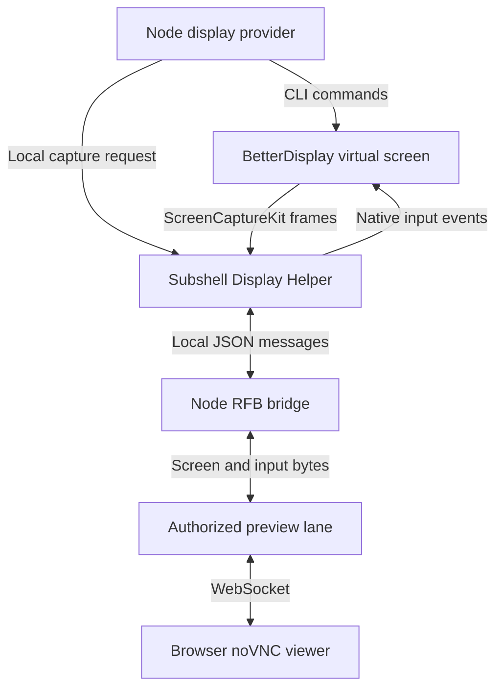

Subshell's macOS display provider connects BetterDisplay virtual screens to the browser viewer through a local helper.

BetterDisplay's CLI creates and removes screens. Subshell's helper captures
frames and handles input through a local Unix socket protocol. A bridge
converts those messages to Remote Framebuffer (RFB), the VNC wire protocol,
for the noVNC viewer.

The local helper protocol is internal and versioned independently from the
server/node wire protocol. It isn't a third-party plugin API. For setup, follow
[Manage nodes](/nodes/manage#macos-display-helper). For the wider data path and
trust boundaries, see [Architecture](/concepts/architecture#web-previews-and-virtual-displays)
and [Security](/concepts/security#preview-security).

For the shared provider contract and a working implementation example, read
[Virtual display architecture](/developers/virtual-display-architecture) and
[Implement a virtual display provider](/developers/virtual-display-provider).

## Connection path



Arrows show management calls or data flow, as labeled. BetterDisplay creates
the screen; Subshell owns capture, input, and viewer transport. Authorization
at the preview lane doesn't add a password to the local RFB listener.

The provider runs on the node that owns the subshell. Neither readiness checks
nor protocol requests launch or enable the helper. Opening its native settings
panel and enabling it are separate local user actions.

## BetterDisplay CLI contract

The adapter was tested with BetterDisplay 5.1.1 on an Apple M5 Mac. Other
versions need validation against the command and output formats below.

The executable comes from the helper's status response, which locates an
already-running app with bundle identifier `pro.betterdisplay.BetterDisplay`.
The provider requires an absolute path ending in
`BetterDisplay.app/Contents/MacOS/BetterDisplay`.

Commands execute as an argument vector, without a shell. The placeholders in
this table represent validated values, not literal arguments.

| Operation | Arguments |
| --- | --- |
| Inventory | `get -identifiers` |
| Create | `create -type=VirtualScreen -virtualScreenName=NAME -useResolutionList=on -resolutionList=WIDTHxHEIGHT -virtualScreenHiDPI=off` |
| Connect | `set -type=VirtualScreen -name=NAME -connected=on` |
| Remove | `discard -type=VirtualScreen -tagID=TAG -name=NAME` |

`NAME` is `Subshell-` followed by a freshly generated UUID, separate from the
subshell ID. Width and height are integers from 320 through 4096. The provider
journals that name before creation and checks inventory before and after
allocation. It persists the resulting UUID and tag ID before attaching capture.

Inventory accepts either a JSON array or the measured comma-separated JSON
objects without enclosing brackets. Responses are limited to 128 KiB and 64
entries. A matching virtual screen has this shape (fictional identifiers):

```json
{
  "name": "Subshell-12345678-1234-4234-8234-123456789012",
  "UUID": "abcdef01-2345-4567-89ab-abcdef012345",
  "tagID": "42",
  "displayID": "99",
  "deviceType": "VirtualScreen"
}
```

The UUID is the macOS screen identity. `tagID` is BetterDisplay's selector;
`displayID` is a transient CoreGraphics ID. Numeric IDs arrive as decimal
strings and must fit an unsigned 32-bit integer greater than zero. A duplicate
name, malformed inventory, or a name matching a non-virtual screen is refused.
An empty inventory cannot prove that an owned screen is absent.

Removal first checks the current name, UUID, and tag ID against the journal,
then sends the qualified discard and verifies absence. Never send an
unqualified `discard`: it removes all virtual screens. A command failure isn't
proof of absence. A timed-out creation retains its journal even if the screen
isn't visible yet, since BetterDisplay might complete the request later. The
provider moves that record into a separate pending-cleanup directory so it
doesn't block retries or closing the subshell. Recovery checks those records
for late-created screens and removes only verified matches.

Provider CLI calls time out after five seconds and bound stdout/stderr through
`execFile`'s 128 KiB limit. The helper independently queries inventory before
capture, with a four-second process deadline and a 128 KiB stdout limit.

## Local helper protocol 1

The helper listens at:

```text
~/Library/Caches/Subshell/display-helper/control.sock
```

This is a Unix stream socket, with a 0700 parent directory and a 0600 socket.
Accepted peers must have the helper's UID. Processes under that OS account
are trusted; there is no bearer token or remote authentication on this socket.
The helper has no network listener.

Each message is one UTF-8 JSON object followed by LF (`\n`). Reads can contain
partial messages or multiple messages. There are no request IDs, reply IDs, or
per-message version fields. A client probes `status` on a short-lived
connection and requires `protocol: 1` before using this implementation. Capture
uses a separate long-lived connection, with at most one `start` per connection.
Unknown operations close the connection; extra object fields aren't rejected.

### Requests

| `op` | Fields | Behavior |
| --- | --- | --- |
| `status` | None | Returns status without prompting or changing consent. Allowed while disabled. |
| `start` | `uuid`, `name`, `width`, `height` | Verifies a Subshell virtual screen and starts capture asynchronously. |
| `pointer` | `x`, `y`, `mask` | Sends input to the selected screen using capture-pixel coordinates. |
| `key` | `symbol`, `down` | Sends an RFB keysym; `down` must be a JSON boolean. |
| `release` | None | Releases this connection's held keys and buttons. |
| `stop` | None | Closes the connection and tears down its capture/input. |

There is no enable, permission-request, login-registration, clipboard, audio,
or arbitrary-command operation. Except for `status`, requests are refused by
closing the connection when the helper is disabled.

For `start`, `uuid` must identify a BetterDisplay `VirtualScreen` whose exact
name matches `name`. The name must have the `Subshell-UUID` shape. Both capture
dimensions must be integers in 320–4096. Main, built-in, mirrored, or vanished
displays are refused. Both Screen Recording and Accessibility must be granted.

Pointer coordinates are integers, zero-based and less than the capture width
and height. They are scaled into the selected display's CoreGraphics bounds.
The mask uses RFB bits: left=1, middle=2, right=4, scroll up=8, down=16,
left=32, right=64. Scroll events are generated on rising edges of those bits.
`symbol` is an unsigned 32-bit keysym. Printable text supports Unicode keysyms;
recognized special keys and ANSI key positions supply native shortcuts. This
isn't a promise of layout-independent shortcut behavior.

Keyboard input requires the focused application's window to be wholly inside
the selected display and is posted to that process. Focus, the pointer, and
application shortcuts still belong to the shared macOS desktop. These checks
don't isolate the subshell from the rest of the account.

### Responses and events

A disabled status response looks like this:

```json
{"type":"status","protocol":1,"enabled":false,"screenRecording":false,"accessibility":false,"betterDisplayExecutable":null}
```

`betterDisplayExecutable` is either the running app's absolute executable path
or `null`. Consent and OS permissions are separate booleans; neither implies
the other. The node's feature/provider policy is enforced outside this response.

| `type` | Fields | Meaning |
| --- | --- | --- |
| `status` | `protocol`, `enabled`, `screenRecording`, `accessibility`, `betterDisplayExecutable` | Read-only readiness facts. |
| `started` | `width`, `height` | Native startup completed. The bridge requires the requested dimensions. |
| `frame` | `jpeg`, `width`, `height` | Base64 JPEG for the full capture surface. Frames may arrive before `started`. |
| `input_blocked` | `message` | Keyboard targeting was refused; held input was released. Capture remains open. |
| `error` | `message` | Capture or protocol failure, followed by connection closure. |

Successful input, `release`, and `stop` have no acknowledgement. Error delivery
is best effort: connection closure can occur before queued diagnostics flush.
Clients must handle EOF without requiring an error message. The RFB bridge
doesn't relay `input_blocked` text as a viewer notification; it continues
streaming without claiming that the keystroke reached its target.

### Limits and teardown

| Resource | Limit |
| --- | --- |
| Accepted helper connections | 16 |
| Concurrent capture reservations | 4 |
| Total reserved capture pixels | 16,777,216 |
| Helper request rate | 200 requests per connection per one-second window |
| Helper buffered incoming data | 65,536 bytes |
| Serialized helper response | 6 MiB |
| Helper queued outgoing data | 8 MiB |
| Node's buffered helper response data | 6 MiB |
| JPEG payload | 4,194,303 bytes |
| Capture rate | At most 5 frames per second |
| Status probe timeout | 2 seconds |
| Capture startup timeout | 10 seconds |

Connections with no established capture, or a still-pending capture, are closed
ten seconds after acceptance. Socket I/O is nonblocking. Oversized buffers,
malformed JSON, invalid fields, or rate excess close the connection. Limits
apply to buffered bytes, so a batch of valid messages can still exceed them.

JPEG encoding runs on a private serial worker with one frame in flight per
capture. Additional frames are dropped while it is busy. Before encoding and
again before sending a completed frame, the helper verifies access.

Each frame and input event rechecks consent, permissions, and selected-screen
identity. An additional one-second timer checks idle captures. Disable closes
connections and releases input immediately. A native startup that finishes
after revocation stops that same stream again; later re-enabling doesn't revive
it. On EOF, the bridge closes viewers and reports display loss. The terminal
keeps running, and display deletion follows the provider's journaled cleanup.

## RFB bridge

The node opens an ephemeral TCP listener on `127.0.0.1` and advertises it through
the existing screen handle: `viewer.protocol = "vnc"`. The browser reaches it
through the authenticated preview lane, not a directly exposed network port.
The listener itself has no password; other local users who can connect to it
can see and control the screen. Don't enable this on a Mac shared with untrusted
local users. See [Security](/concepts/security#preview-security).

The supported negotiation is deliberately narrow:

1. Both ends exchange `RFB 003.008\n`.
2. The server offers only security type 1 (None), then returns a successful
   SecurityResult when the client selects it.
3. ClientInit leads to ServerInit with the capture dimensions, a 32-bit,
   24-depth true-color pixel format, and the name `Subshell virtual display`.
4. The client must offer Tight encoding (7). Updates contain one full-surface
   rectangle with Tight JPEG control byte `0x90` and its compact length.

The bridge consumes SetPixelFormat, SetEncodings, FramebufferUpdateRequest,
KeyEvent, PointerEvent, and ClientCutText. It doesn't implement raw pixel
encoding or clipboard transfer. Clipboard messages are bounded and discarded;
SetPixelFormat accepts 32-bit, 24-depth true-color formats with eight bits per
channel; byte order and channel order don't affect JPEG encoding. Unknown message types or a
SetEncodings list without Tight close the viewer.

There are at most eight viewers per bridge. Handshakes have a ten-second
limit, incoming buffers are bounded at 128 KiB, outgoing queues at 8 MiB,
encoding lists at 256 entries, and clipboard payloads at 65,536 bytes.
Incremental updates wait for a new frame generation; a nonincremental request
can resend the latest frame. Only the latest frame is retained.

Viewers share one native input connection. When control switches viewers, the
bridge releases the previous viewer's held input. Disconnecting the controlling
viewer also releases input; disconnecting a passive viewer doesn't. Helper
loss closes all viewers and the listener.

## Changing this contract

Update this document alongside the implementation. The status consumer rejects
protocol versions other than 1. An incompatible change needs a new version and
an explicit compatibility decision for independently updated desktop helpers
and node/server binaries; don't silently reinterpret an existing field.

