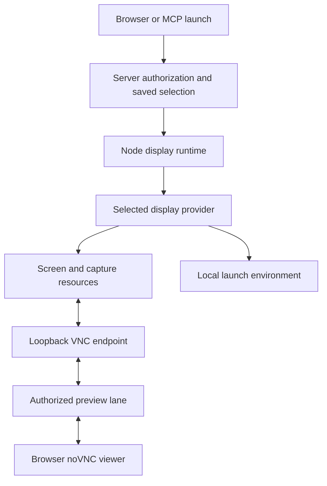
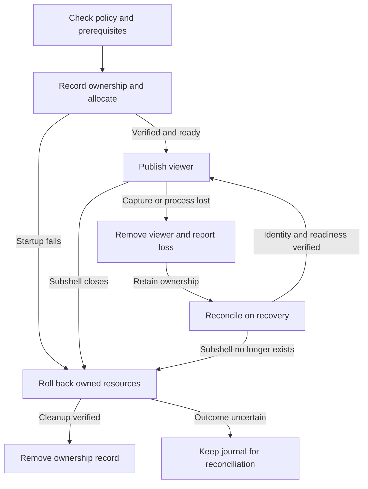

A virtual display provider connects a machine-local screen to a subshell's launch environment and authenticated viewer.

## Separate the responsibilities

Creating a screen, capturing pixels, carrying those pixels to a browser, and
injecting input are separate jobs. A provider coordinates the machine-local
parts. The shared runtime adds node policy and provider selection; the server
adds user authorization and preview connections.



The server's built-in node uses the same runtime in the server process.
Enrolled nodes receive launch commands through their authenticated, encrypted
node link. The arrows show responsibilities and data flow, not end-to-end
encryption: the server can read preview bytes.

| Responsibility | Linux | macOS |
| --- | --- | --- |
| Create screen | Xvfb | BetterDisplay CLI |
| Capture and input | x11vnc | Subshell Display Helper using ScreenCaptureKit and native input events |
| Local viewer endpoint | x11vnc Remote Framebuffer (RFB) listener | Subshell's RFB bridge converting helper JPEG frames |
| Launch environment | `DISPLAY` and `XAUTHORITY` | `SUBSHELL_DISPLAY_UUID` and `SUBSHELL_DISPLAY_NAME` |
| Window placement | X11 apps use their inherited display | Apps share the login desktop; the environment doesn't automatically place windows |
| Additional consent | Node/provider opt-in | Node/provider opt-in, native helper consent, and macOS privacy permissions |

These are statically bundled providers, not installable harness or network
plugins. Adding a provider requires a source change and rebuilt server/node
binaries. The provider interface isn't a sandbox or a separately published SDK.

## Follow a display's lifetime

1. The launch form or MCP checks prerequisites. Readiness reports platform
   support and missing requirements without creating a screen, launching a
   GUI, enabling a helper, or requesting privacy permission.
2. The server checks launch authorization, the node feature flag, and the
   enabled provider set. An omitted provider resolves to the node default;
   the subshell saves that choice for restart.
3. The node runtime validates identity and dimensions, checks policy and
   readiness, and calls the selected provider's `openFor`.
4. The provider records ownership, creates or attaches resources, verifies
   their identity and readiness, and returns a public descriptor. The runtime
   rechecks policy after allocation and closes a new display if permission
   changed while startup was pending.
5. The launcher merges `launchEnv` into the process environment. Those values
   stay local; the public descriptor carries no launch secrets.
6. An edit-authorized user opens the screen through the preview API. The
   server issues a private capability path and forwards RFB bytes to the
   registered loopback port. noVNC draws frames and sends input back.
7. Losing capture removes the live descriptor and reports loss without
   killing the terminal. Explicit cleanup closes owned resources. After a
   daemon restart, a complete subshell census drives recovery and orphan cleanup.

Changing the default affects new launches, not an existing display's owner.
Disabling a provider prevents new allocations and restarts that need it;
cleanup remains available. Disabling the macOS helper is stronger: it stops
capture and input across its connections. See [Security](/concepts/security#preview-security)
for connection lifetimes and revocation.

### Failure and recovery paths



The arrows show resource transitions, not terminal state. Losing a display
keeps the terminal alive. On restart, recovery checks ownership against live
resources before restoring a viewer; a retained journal alone doesn't prove
that a screen still exists.

## Provider contract

The contract is `VirtualDisplayProvider` in the shared pane runtime. Providers
have a stable `id` and implement these methods:

| Member | Input and result | Required behavior |
| --- | --- | --- |
| `readiness()` | Returns `{ supported, missing }`, directly or asynchronously | Read-only prerequisites. Unsupported hosts return `supported: false`; missing prerequisites don't imply permission to install or enable anything. |
| `openFor(paneId, size)` | Resolves to a `PreviewScreenHandle` | Allocate or return the existing display. Resolve only when its viewer is ready; reject failed or ambiguous startup. |
| `getFor(paneId)` | Descriptor or `null` | Synchronous lookup of a verified live allocation. Never return a stale port after loss. |
| `launchEnv(paneId)` | String-to-string environment map | Local launch settings for an allocated display. Throw if unavailable; never add these secrets to the descriptor. |
| `lostFor(paneId)` | Reason string or `null` | Explain a display loss while the terminal remains alive. Clear stale loss on successful allocation or close. |
| `closeFor(paneId)` | `void` or a promise | Idempotent cleanup, including while disabled. Stop access before attempting slower resource deletion; verify ownership before destructive operations. |
| `sweepOrphans(alivePaneIds)` | Promise of `{ reaped, rehydrated, locksFreed }` | Use a complete census to recover verified live resources or remove verified orphans. A failed census is not an empty census. |

A request contains integer `width` and `height` from 320 through 4096 and an
optional provider ID. Provider IDs use lowercase letters, digits, and hyphens,
start with a letter, and have at most 64 characters. Readiness has at most 32
nonempty missing-requirement strings, each at most 128 characters.

The public descriptor is:

```ts
{
  display: "opaque-provider-screen-id",
  viewer: { protocol: "vnc", port: 5910 }
}
```

`display` is a nonempty opaque string of at most 256 characters, not necessarily
an X display number. The port is
a valid TCP port on the execution machine's loopback interface. It isn't a
public address, and returning a descriptor doesn't authorize anyone to use it.

### Failure categories

Provider methods reject with errors that the launch and node RPC layers expose
as refusals. Keep the established prefixes when the corresponding condition
applies, and append useful diagnostic text without secrets.

| Prefix | Meaning |
| --- | --- |
| `preview-display-unsupported` | The selected backend doesn't support this host. |
| `preview-display-missing-requirements` | Required programs or permissions are missing. |
| `preview-display-not-ready` | Allocation, identity verification, or startup readiness failed. |
| `preview-node-off` | The runtime refused node policy. |
| `preview-display-provider-disabled` | The requested provider isn't enabled. |
| `preview-display-provider-conflict` | Another provider already owns this subshell's display. |

A returned readiness result is a prerequisite report, not an allocated display.
A resolved allocation promise is stronger: callers may launch applications and
advertise the viewer. Don't return a placeholder port while startup continues.

## Runtime guarantees and provider obligations

The runtime orders opens and closes for the same subshell. Competing providers
can't acquire that subshell simultaneously through this runtime. Different
subshells can allocate concurrently, so shared resource limits, display-number
claims, and port reservations still belong to the provider. Another process
isn't covered by an in-memory queue; use durable ownership and OS locks when
needed. Recovery must also avoid racing pending allocations.

Readiness may become stale immediately. The provider must check native consent,
resource identity, and actual readiness during allocation and use. Give external
commands and handshakes deadlines, bound output, and handle partial startup.

Roll back verified resources after a failure. If a creation timed out and might
finish later, or deletion can't establish ownership, keep a durable journal for
reconciliation instead of claiming success or deleting a possibly foreign
resource. Cleanup failure must not leave a usable viewer registered. BetterDisplay's
journal behavior illustrates this distinction; Xvfb verifies process arguments
and listener ownership before recovering or signalling saved PIDs.

A provider namespace keeps records separate from other providers and instances.
Use private directory/file permissions, reject invalid subshell IDs before
constructing paths, and treat recorded PIDs, ports, names, and UUIDs as claims
to revalidate. A responding port alone doesn't prove resource ownership.

## Reuse VNC or introduce another viewer protocol

A provider exposing RFB can reuse noVNC and the existing authenticated preview
lane. It must bind its listener to loopback and obey the viewer's frame and
decoding limits. Both bundled providers use that route; BetterDisplay's helper
JSON is converted into RFB locally rather than sent directly to the browser.
See [BetterDisplay integration protocol](/developers/betterdisplay-protocol)
for the supported macOS RFB subset.

A different viewer protocol needs coordinated changes to the shared descriptor
type and wire validators, server/node transport handling, `ScreenViewer`
dispatch, a browser adapter, and compatibility/error tests. Adding a new string
to the provider catalog alone doesn't create a new transport. Older nodes must
refuse unsupported descriptors instead of treating them as VNC.

## Security boundaries

Providers run with the host account's privileges. Remote control requires
subshell edit access, but a copied preview capability conveys that control
until expiry or revocation. Local VNC listeners have no separate password;
other local users who can reach them are trusted. Linux Xauthority protects
X11, not VNC. macOS virtual screens also share desktop focus, pointer state,
and application authority.

A native helper must keep activation and privacy prompts under explicit local
user control. Keep disable available during failed updates and pending startup,
release held input on disconnect, and prevent late asynchronous work from
reviving access after revocation. Don't describe a virtual display as a sandbox.

## Next steps

Follow [Implement a virtual display provider](/developers/virtual-display-provider)
for a working Linux example, registration steps, and a validation checklist.
