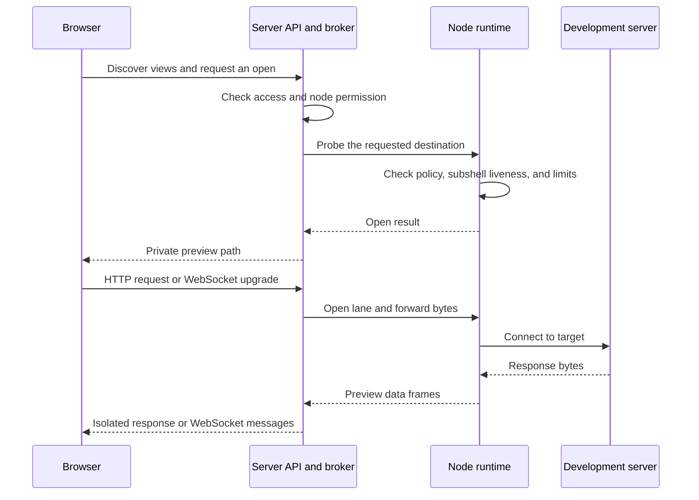
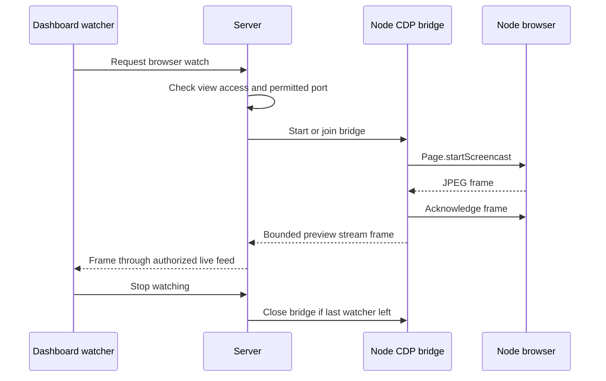

Web previews connect a subshell's development server to your browser through Subshell's existing server and node transport.

## Three different views

| View | What travels | Access | Requires a virtual display? |
| --- | --- | --- | --- |
| Web preview or saved service | HTTP requests/responses and application WebSocket messages | Subshell edit access | No |
| Browser watch | JPEG frames from a browser's Chrome DevTools Protocol (CDP) connection | Subshell view access, with discovered-port restrictions | No |
| Virtual display | RFB frames and keyboard/pointer input | Subshell edit access | Yes |

A web preview renders the target website in your browser. A browser watch shows
what a browser on the node rendered and doesn't provide interactive control.
A virtual display lets you control graphical applications on the node. Read
[Virtual display architecture](/developers/virtual-display-architecture) for
that separate provider interface.

## Responsibilities and data path

The server owns authorization, capability references, cookie jars, lane queues,
watch audiences, and revocation. The node owns target connections and browser
capture. An enrolled node uses its established authenticated, encrypted link;
preview doesn't expose a separate node listener to the network. The server's
built-in node calls the same shared runtime in process.

The server remains a trusted endpoint and can read the bytes. Browser-to-server
transport needs HTTPS for confidentiality; encryption on the node link doesn't
make this end-to-end encrypted from browser to target.

## Discovery is separate from permission

`GET /api/subshells/:id/views` requires view access and reports available ports,
a discovered browser port, screen metadata, and availability reasons. Linux
discovery walks the subshell's tmux process tree and joins its descendants'
open socket inodes to listening TCP sockets. The server caches results for
five seconds. Automatic process-tree discovery doesn't run on macOS; saved
HTTP(S) services and provider-owned display lookup don't require it.

Discovery helps populate the picker. It isn't a security allowlist for an
edit-authorized user, who already has the execution account's shell authority.
View-only browser watching is narrower: it can use only the browser port
reported for that subshell. An explicit different port requires edit access.

**Allow web previews** and **Allow virtual displays** are independent node
settings, both off by default. The server checks stored policy; enrolled nodes
check its signed local mirror. Having a transport connection or a successful
prerequisite check doesn't authorize either feature.

## Open a forwarding session

An edit-authorized `POST /api/subshells/:id/views/open` accepts a port or saved
service ID. The broker probes node availability and rechecks authorization
before returning a path such as `/pv/REFERENCE/`. The reference is a random
128-bit bearer capability: possession of the path grants access. Later requests under that path use the reference,
not the opener's dashboard cookie, as their credential.

A forwarding session and a lane aren't the same object. The session retains
the destination and cookie jar. Each HTTP request or WebSocket connection
gets its own lane. The node's forward-open acknowledgement can precede its
TCP connection; later connection failures arrive as a close event. Callers
must handle both startup refusal and failure after acknowledgement.

For an automatic web preview, the node dials loopback. A saved service stores
an explicit hostname or IP, port, and HTTP/HTTPS protocol under the subshell.
Saving doesn't dial or start anything. Opening resolves DNS and validates TLS
certificates on the node. The destination is read from the stored service,
not reconstructed from untrusted workspace-panel parameters. Removing a saved
service revokes its preview sessions without stopping the service itself.

## HTTP forwarding and browser isolation

The server serializes the target request over a lane; it doesn't connect to
the target directly. The proxy:

- Strips dashboard cookies, HTTP authorization, API keys, and recognized
  reverse-proxy identity headers before forwarding.
- Sets the target Host header, streams request and response bodies, and
  doesn't retry a partially written request.
- Retains target cookies in a bounded server-side session jar rather than
  installing them on the dashboard origin.
- Prefixes root-relative redirects with the capability path. It doesn't
  rewrite HTML, JavaScript, or asset URLs.
- Applies a Content Security Policy (CSP) sandbox without `allow-same-origin`, plus `no-store` and
  `no-referrer`. Embedded previews also have an iframe sandbox.
- Removes target headers that could change dashboard-origin state or policy,
  including Clear-Site-Data, authentication challenges, and HSTS.

The preview document has an opaque origin, separate from the dashboard's origin. It can't read dashboard storage or
authenticated API responses. Preview-specific CORS allows module loading and
fetches under the capability path, including opaque `Origin: null` requests.
That exception doesn't apply to dashboard API or WebSocket origin checks.

The cookie jar isn't a full browser cookie implementation: it keys by cookie
name. Applications that require service workers, browser storage,
JavaScript-managed cookies, or a normal website login context should run in
the node's browser and be checked through a virtual display. Don't weaken the
sandbox to make such applications work.

## Application WebSockets

A WebSocket upgrade validates origin and the live capability, then reserves a
lane before accepting the browser. In HTTP mode, the server performs a real
upstream WebSocket handshake over that lane, using the session's target cookies.
In raw mode, used for a registered virtual display, it forwards RFB bytes.
Saved HTTP(S) services always use HTTP mode.

Binary messages preserve bytes. JSON-looking text frames can be parsed and
reserialized by the server's WebSocket framework, preserving meaning but not
necessarily whitespace. Applications requiring byte-identical text framing
need explicit compatibility work; don't assume the proxy is a transparent TCP
connection. The raw VNC mode isn't a general-purpose public TCP tunnel API.

## Browser watching

The node discovers a browser's CDP endpoint on loopback, rejects redirects and
WebSocket destinations that leave loopback or change the requested port, and starts
`Page.startScreencast`. Frames are acknowledged and forwarded as bounded JPEGs.
The server delivers them only to explicitly authorized watch subscriptions on
`/ws/live`; subscribing to a subshell's terminal output doesn't grant frames.

Watchers share a bridge. Unwatching releases that watcher; the bridge closes
when its last watcher leaves. A static page needn't produce new frames to
remain watched. Permission downgrades repeat the discovered-port restriction,
and account or share revocation removes affected recipients.

The arrows show watch registration, frame delivery, and release. Watching uses
an authorized live-feed subscription, not the forwarding capability described
above. Receiving frames doesn't grant keyboard or pointer control.

## Lifetime and backpressure

Closing a preview tab releases its connections, but a copied capability can
remain usable until revocation or expiry. Forward sessions expire after 15
minutes without traffic; each lane or browser bridge has a four-hour ceiling.
Share changes, account disable, subshell lifecycle actions, and node loss close
or prune affected state. Pending opens participate in those checks too.
Turning node preview permission off prevents new operations; it isn't an
emergency drain of existing connections.

| Resource | Bound |
| --- | --- |
| Preview payload frame | 256 KiB |
| Lane buffers, target write queues, and browser WebSocket debt | 1 MiB each |
| Assembled application WebSocket message | 1 MiB |
| Forward lanes per subshell / waiting lanes | 4 / 8 |
| Active lanes and browser bridges per node | 16 total |
| Retained forwarding sessions / pending opens per node | 64 / 32 |
| Cookie jar | 128 entries, 64 KiB total, 4 KiB per cookie |
| Browser watch subscribers / frame rate | 8 / up to 5 fps |

These budgets protect the transport, not the host from programs running under
its execution account. Oversized data, slow consumers, timeout, and revocation
must converge on cleanup that closes both ends and releases capacity. A failed
or ambiguous open response needs best-effort cleanup of its node reference.

## Where extensions belong

There is no web-preview provider plugin API. Change the layer that owns the
behavior: discovery for new port sources, the shared forwarder for destination
transport, the server proxy for HTTP/WebSocket semantics, or the CDP bridge for
browser capture. Wire-shape changes also need shared validators and old-node
compatibility handling. Both the enrolled node and built-in node must behave
the same way.

Follow [Develop and extend web previews](/developers/web-preview-development)
for a runnable target, the implementation map, and validation requirements.
See [Security](/concepts/security#preview-security) for the enforced boundaries
and accepted risks.
