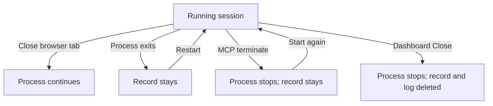

Choose whether to disconnect, restart, or permanently close a subshell.

## Process and record lifecycle

Retained logs are subject to retention limits. Restarting a session doesn't guarantee that its agent can resume a conversation.

## Disconnect a viewer

Closing a browser tab disconnects that viewer. It doesn't stop the agent or remove the subshell. The machine must remain running for its process to continue.

## Restart a session

When a process exits, the subshell may remain listed with `status: "running"` and `alive: false`. In the server dashboard's sidebar, choose **Subshells**, open the session's **⋯** menu, and choose **Restart** to revive it in place. A terminated subshell offers **Start again**.

Restarting a running subshell interrupts its current work. The subshell keeps its ID and starts again with its saved agent, preset, and working directory. Whether the agent can resume its conversation depends on the agent and its saved history. Subshell also replaces the session's credentials.

## Close permanently

> [!warning] Permanent removal
> **Close** stops the process and removes the subshell's record and captured history. You can't undo this.

To close a session you own, open its **⋯** menu on the **All subshells** page and choose **Close**, then review the warning and select **Close subshell**. Only the owner can close a subshell. Removing a subshell also removes its workspace pane references. This doesn't delete the project's files or the agent CLI's separate conversation storage.

## Stop a session and keep its record

Use MCP's `terminate_subshell` or the REST terminate endpoint to stop a process and keep its session record. Their delete operations remove the record. In the dashboard, **Close** permanently deletes the subshell.

Captured logs of retained terminated subshells are subject to the retention settings listed in [Environment variables](/reference/environment).

## Next steps

Read [Helper lifecycle](/mcp/lifecycle) when agents create sessions on your behalf.
