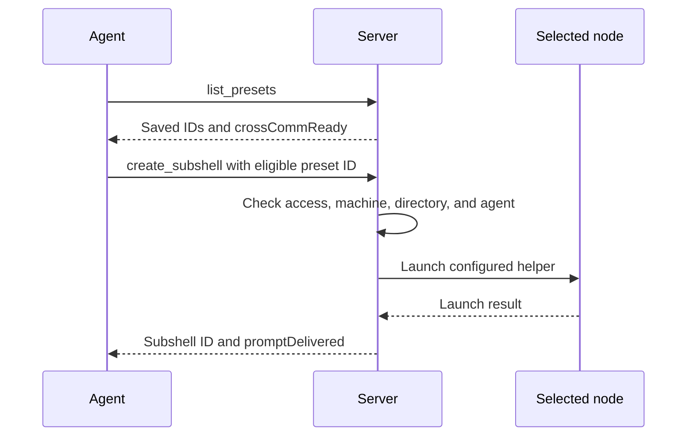

Reuse a saved preset when starting another subshell.

For SSH presets, select **SSH** on the **Presets** page. A preset’s **Connect** action opens a filled connection form without starting it. See [Connect over SSH](/guides/ssh#ssh-presets-and-recent-destinations).

## Launch an agent from the dashboard

1. In the server dashboard sidebar, open **Workspaces**, find the **Subshells** section, open the **⋯** menu beside the grouping dropdown, and choose **Add subshell**. If a workspace is open, select **New subshell** in the dialog.
2. Choose the agent and your saved preset.
3. Review the machine, working directory, and prompts filled from the preset. Change them for this launch if needed.
4. Launch and confirm that the agent reaches its normal prompt.

Changing a field in the launch form changes that launch; it doesn't update the saved preset. See [Launch a subshell](/guides/launch).

## Share a preset

You must own a preset to manage its sharing. In the dashboard sidebar, open **Settings** → **Presets**, choose **Agent** or **SSH**, and open the preset's **⋯** menu.

1. Choose **Share preset**.
2. Select a person or **Everyone**, then choose **View** or **Edit** and select **Add**.
3. Select **Save** to apply the grants. Save stays disabled until something changes; Cancel discards your edits.

**Everyone** means authenticated users of this instance, not a public link. View access lets someone inspect, use, and clone the preset. Edit access also lets them change its saved settings. Only the owner can share or delete it, including when another user is an administrator.

Sharing an agent preset exposes all of its saved settings, including environment variables and any secrets stored in them. Editors can change the configuration used by future launches and restarts. Only grant access to people you trust with those settings.

Sharing an SSH preset exposes its destination and connection choices. It doesn't grant access to the connecting node, the node providing keys, or destination approvals. Those checks still apply when someone connects.

Shared presets appear in the recipient's Presets page and launch pickers, with the owner's name. A viewer can choose **View preset** to inspect the settings or **Clone preset** to make a private copy.

To revoke access, open **Share preset**, select **Remove** beside the grant, and save. Remove an Everyone grant too if it still gives that person access. Revocation prevents new use of the preset; it doesn't stop running subshells, erase copies, or undo information already disclosed. A subshell using a revoked agent preset needs another preset, or no preset, before it can restart.

Machine tokens don't inherit preset sharing. MCP helpers can still use only their owner's presets.

<figure className="docs-screenshot">
  <ImageZoom src="/screenshots/preset-sharing.png" alt="Preset sharing dialog with View and Edit permission controls and Save for applying grants." width="1072" height="968" loading="lazy" decoding="async" unoptimized />
  <figcaption>Sharing applies to the saved preset. Node access and SSH destination approvals remain separate. Select the image to enlarge it.</figcaption>
</figure>

## Export or import

To export an agent or SSH preset you can view, open **Settings** → **Presets** in the dashboard sidebar, open its **⋯** menu, and choose **Export preset**. Your browser downloads a JSON file named after the preset with a `.preset` extension. Characters that aren't safe in a filename are replaced with underscores.

Exports include all saved settings. An agent preset can include environment secrets and prompt text, so treat its exported file accordingly. Ownership, sharing grants, and timestamps aren't exported. SSH exports include connection choices and public key fingerprints, never private keys, passwords, or destination approvals.

If an exported preset refers to a deleted node, you can still export it. Choose
replacement nodes in the import dialog before importing; SSH key selections and
node permissions are checked again when you connect.

To import a file:

1. In the server dashboard's sidebar, open **Settings** → **Presets**, select **New preset**, and choose **Import preset**.
2. Use **Preset file** to choose the file through your browser.
3. Review its name and settings. Choose nodes on the current instance if the original nodes aren't available. Use a new name if you already own a preset with that name.
4. Select **Import preset**.

Import creates a new private preset without starting a subshell. The dialog validates the file before enabling Import, and the server checks permissions, agent availability, name conflicts, and applicable SSH destination settings before saving. A rejected import stays open so you can correct it.

Preset files use the `subshell-preset` format with `version: 1` and a `preset` object whose `kind` is `agent` or `ssh`. The importer rejects malformed files, unknown fields, unsupported versions, and files larger than 1 MiB. It doesn't overwrite an existing preset or grant access to the nodes named in the file.

## Edit or clone

If you own a preset or have Edit access, open **Settings** → **Presets** in the dashboard sidebar, open its **⋯** menu, and choose **Edit**. Change its values and select **Save**. Existing processes keep their launch-time configuration.

To keep the original, open the preset row's **⋯** menu and choose **Clone preset**. Give the copy a distinct name and review its values before saving. The agent stays the same; create a new preset to choose a different agent.

Use [Clone and switch presets](/guides/clone) for actions on an existing subshell rather than on the library entry.

To remove a library entry, choose **Delete preset** from its **⋯** menu and review the confirmation. Existing subshell records remain, but their association with that preset is cleared. Keep any configuration you need before deleting it.

## Use from an agent

MCP's `list_presets` returns agent presets only, including your saved preset IDs and `crossCommReady`. A preset is ready for agent-created launches only when its MCP switch is enabled and a machine and directory are saved. Catalog entries aren't saved presets: an agent harness catalog entry needs a saved preset before `create_subshell` can launch it, while a plain terminal harness can launch presetless (see [Terminal sessions](/mcp/terminals)).

Choose an ID from `list_presets`; don't guess one from the display name. An agent's task can append to the preset's saved prompt or replace it using `prompt_mode`. Check `promptDelivered` when an initial task was requested; a created session doesn't prove that task arrived.

The agent that creates a helper must clean it up when the work is done. Follow [Coordinate agents](/mcp/coordinate).

## Next steps

Build task text with [Reusable Prompts](/prompts) or review [MCP tool reference](/mcp/tools).
