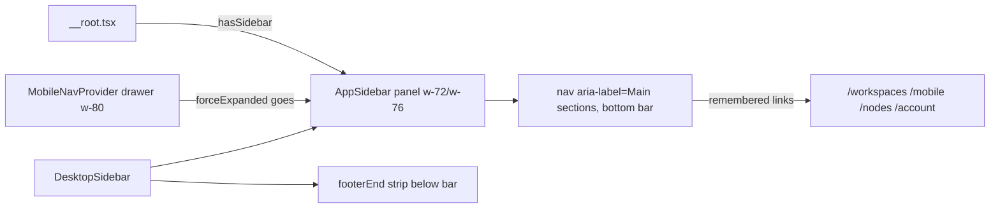
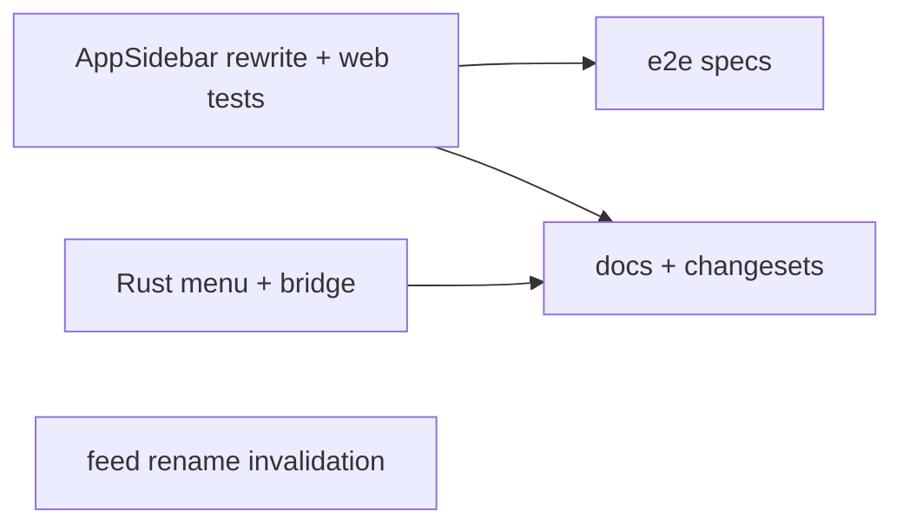

# Plan: mini rail out, bottom section bar in

**Goal:** delete the icon rail from `AppSidebar` everywhere (browser, desktop, drawer); dock its section links as a horizontal bar at the bottom of the wide panel; retire panel collapse and the desktop "Toggle Sidebar" action.
**Architecture:** one React component (`app-sidebar.tsx`) changes shape; its call sites (`mobile-nav-provider.tsx`, `desktop-sidebar.tsx`, desktop bridge hooks) shed the `collapsed` plumbing; the Tauri server app drops the menu item; specs/docs/changesets follow.
**Tech stack:** React 19 + Tailwind + TanStack Router (bun tests), Rust (Tauri), Playwright e2e.
**Spec path:** docs/plans/2026-10-20-sidebar-bottom-bar.spec.md
**Detail:** contracts
**Target-min:** 14

Global constraints (spec §3 FROZEN; briefs point here, never restate):
- `nav` keeps `aria-label="Main sections"`; link names exactly "Workspaces", "Subshell for Mobile", "Settings", "Account", "Open in browser"; active link carries `aria-current="page"` plus `bg-accent text-accent-foreground`.
- No logo link. Bar buttons: `size-11` icon links (`size-5` lucide icons), tooltip `side="top"`, amber `bg-warning` dot on Account when an update exists.
- Bar layout: `border-t border-border` row at the panel bottom, buttons in a centered row; bar is inside the panel column, below the scroll area, above the desktop `footerEnd` strip.
- Click semantics (spec §1): modifier/middle clicks pass through; inside `/workspaces/$id` a Workspaces click on the active section prevents navigation; every other active click navigates to the remembered destination; drawer section clicks still call `onSectionNavigate`.
- Removals (spec §2): no `subshell.sidebarCollapsed`, no `forceExpanded` prop, no `collapsed`, no `aria-expanded`, no `toggle-sidebar` listener branch.
- `__root.tsx` mount lines stay untouched (root-frame-guards greps `bare` on them).
- Prose: no U+2014 (lint:prose); copy per repo voice; design tokens only, no literal sizes beyond existing classes.
- Test command: `bun test <files>` from `apps/server/web`; full suite `bun run test`; Rust: `bun run rust:check`.

File structure:
- `apps/server/web/src/components/app-sidebar.tsx` - panel + bottom bar (rewrite of the nav half).
- `apps/server/web/src/components/mobile-nav-provider.tsx` - drawer, drops `forceExpanded`.
- `apps/server/web/src/components/desktop/desktop-sidebar.tsx` - footerEnd ctx loses `collapsed`.
- `apps/server/web/src/hooks/use-desktop-bridge.ts`, `src/lib/desktop.ts` - shed `toggle-sidebar` naming if present.
- `apps/server/desktop/src-tauri/src/menu.rs`, `bridge.rs` - drop the menu item + action variant.
- `e2e/tests/30-context-sidebar.spec.ts`, `e2e/tests/08-mobile-shell.spec.ts`, `e2e/capture-product-demo.ts` - collapse-free expectations.
- `apps/server/web/docs/sidebar.md`, `apps/server/web/AGENTS.md` - mini-rail paragraphs rewritten.

```mermaid
%% schedule
gantt
  title Predicted schedule (mm:ss)
  dateFormat X
  axisFormat %M:%S
  section lane 1
  T1 AppSidebar rewrite + web tests :t1, 0, 147s
  T2 e2e specs :t2, 147, 132s
  section lane 2
  T3 Rust menu + bridge :t3, 0, 129s
  T4 docs + changeset :t4, 147, 127s
  section lane 3
  T5 feed rename invalidation :t5, 0, 100s
```

critical path: T1 → T2 (4.7 min) · peak width 3 · predicted build 4.7 min · predicted total ≈ 8.2 min (target ✓)

## Section: web SPA

**Probe entry:** run=bun test apps/server/web/src/components/__tests__/app-sidebar-group.test.tsx · serve=-

### T1 AppSidebar rewrite + web tests · Complexity 5 (O-1) · Est. context 55k
**Owns:** apps/server/web/src/components/app-sidebar.tsx, apps/server/web/src/components/mobile-nav-provider.tsx, apps/server/web/src/components/desktop/desktop-sidebar.tsx, apps/server/web/src/hooks/use-desktop-bridge.ts, apps/server/web/src/lib/desktop.ts, apps/server/web/src/components/__tests__/app-sidebar-group.test.tsx, apps/server/web/src/components/__tests__/app-sidebar-account.test.tsx
**Components:** 2
**LOC owned:** 260
**Tests:** fast
**Kind:** design
**Model:** sonnet
**Est. time:** 5.5 min
**Consumes:** -
**Produces:** -
**Review Focus:**
- `test_section_bar_named_links_no_logo`: bar exposes exactly the four section links (+ "Open in browser" only when `isDesktop()`); no link named "Subshell"; nav name still "Main sections".
- `test_no_collapse_pref_or_state`: after clicking active "Settings" from `/nodes`, `localStorage.getItem("subshell.sidebarCollapsed")` is null and the "Settings pages" nav is still in the tree.
- `test_active_click_goes_to_remembered_page`: visit `/presets`, go to `/workspaces`, click Settings → `/presets`; inside `/workspaces/w1` an active Workspaces click leaves the URL unchanged.
- `test_active_section_marks_current`: the section link matching the route carries `aria-current="page"`.
- `test_modified_click_passes_through`: onClick with `metaKey: true` is not preventDefaulted.
**Steps:** 1 rewrite the two named unit tests to the new semantics and add the cases above (run: FAIL); 2 rewrite `app-sidebar.tsx` (nav → bottom bar; drop collapse/forceExpanded/logo; keep remembered-destination ref, badge dot, About dialog, focus-filter effect); 3 update `mobile-nav-provider.tsx` (no `forceExpanded`; drawer close selector already matches the nav label) and `desktop-sidebar.tsx` (`footerEnd()` ctx without `collapsed`); 4 remove any `toggle-sidebar` branch in `app-sidebar.tsx`/`use-desktop-bridge.ts`/`desktop.ts` (keep `focus-filter`); 5 run: PASS; also run `bun test` on `app-sidebar.test.ts`, `app-sidebar-node-groups.test.tsx`, `sidebar/__tests__/unified-sidebar.test.tsx` and fix fallout minimally.
**Notes:** keep the aside as the single panel (`w-72`/`w-76`, no `w-14` state); bar row uses `px-2 py-1` with `justify-center gap-1`; header h2 and headerEnd placement unchanged; the `account` identity footer stays above the bar.

## Section: e2e

**Probe entry:** run=bun run test:e2e -- 30 08 · serve=-

### T2 e2e specs · Complexity 3 (O-2) · Est. context 30k
**Owns:** e2e/tests/30-context-sidebar.spec.ts, e2e/tests/08-mobile-shell.spec.ts, e2e/capture-product-demo.ts
**Components:** 1
**LOC owned:** 50
**Tests:** slow
**Kind:** design
**Model:** sonnet
**Est. time:** 3 min
**Consumes:** -
**Produces:** -
**Review Focus:**
- `rail clicks never collapse the panel` (30): clicking active "Settings" twice on `/presets` keeps the "Settings pages" nav visible.
- destination-restore leg (30, existing lines 72-84): kept; delete only the trailing collapse-toggle clicks (the `toHaveCount(0)`-then-`toBeVisible()` combobox toggling).
- 08: rail-in-drawer navigation keeps passing through "Main sections" names; assert no spec there still clicks expecting the panel to collapse; capture-product-demo stops writing `subshell.sidebarCollapsed`.
**Steps:** 1 read both specs for collapse semantics; 2 edit per spec §5; 3 run the two specs targeted if the environment allows (`bun run test:e2e tests/30-context-sidebar.spec.ts`), else hand the command to CI in the DONE note.
**Notes:** workers:1 and shared DB mean run one file at a time.

## Section: desktop Rust

**Probe entry:** run=bun run rust:check · serve=-

### T3 Rust menu + bridge · Complexity 2 (O-1) · Est. context 22k
**Owns:** apps/server/desktop/src-tauri/src/menu.rs, apps/server/desktop/src-tauri/src/bridge.rs
**Components:** 1
**LOC owned:** 30
**Tests:** slow
**Kind:** design
**Model:** sonnet
**Est. time:** 1.5 min
**Consumes:** -
**Produces:** -
**Review Focus:**
- `no_toggle_sidebar_anywhere`: `ToggleSidebar`, "Toggle Sidebar" and "toggle-sidebar" are absent from both crates after the edit; the CmdOrCtrl+B accelerator is gone, no other item reclaims it.
- `rust:check green`: fmt, clippy -D warnings, cargo test across the three crates.
**Steps:** 1 delete the menu item, enum variant, `as_str` arm and the list entry at bridge.rs ~69; 2 grep both desktop crates for leftovers; 3 `bun run rust:check`.
**Notes:** `focus-filter` and the other actions keep their slots; do not touch apps/client/desktop.

## Section: docs

**Probe entry:** run=bun run lint:prose · serve=-

### T4 docs + changeset · Complexity 2 (O-2) · Est. context 25k
**Owns:** apps/server/web/docs/sidebar.md, apps/server/web/AGENTS.md, .changeset/sidebar-bottom-bar.md
**Components:** 2
**LOC owned:** 100
**Tests:** fast
**Kind:** design
**Model:** sonnet
**Est. time:** 2 min
**Consumes:** -
**Produces:** -
**Review Focus:**
- `docs_describe_the_bar`: sidebar.md mini-rail/collapse/drawer paragraphs describe the bottom bar, say collapse is gone, and AGENTS.md's mini-rail lines agree; no claim of a collapse toggle survives in either file (grep "mini rail", "mini-rail", "Collapsing", "collapses/expands").
- `changeset_shape`: one changeset file listing `@internal/server` and `@internal/desktop-server` patch bumps, voice-clean, no CHANGELOG.md edited.
- `lint:prose` and `bun run lint:design` clean on the touched files.
**Steps:** 1 read the shipped `app-sidebar.tsx`/`desktop-sidebar.tsx` for the exact shape before writing prose; 2 rewrite the named paragraphs; 3 write the changeset; 4 run the two linters.

## Section: live feed (buglist fix)

Bug: rename updates the sidebar row live but an open dock tab keeps the old title. Root cause: the feed's `subshell` update frame (`use-live-subshells-feed.tsx` lines 279-311) writes `["subshells"]` and `["subshell", id]` only; the dock tab names come from `["workspace", id]` pane rows (`workspace-dock.tsx` re-titles on `detail.panes` change, line 285-290) and that read is NOT polled and uninvalidated for a remote rename.

**Probe entry:** run=bun test apps/server/web/src/hooks/__tests__/live-subshells-feed.test.tsx · serve=-

### T5 feed rename invalidation · Complexity 3 (O-1) · Est. context 30k
**Owns:** apps/server/web/src/hooks/use-live-subshells-feed.tsx, apps/server/web/src/hooks/__tests__/live-subshells-feed.test.tsx
**Components:** 1
**LOC owned:** 80
**Tests:** fast
**Kind:** design
**Model:** sonnet
**Est. time:** 2.5 min
**Consumes:** -
**Produces:** -
**Review Focus:**
- `test_update_frame_rename_invalidates_workspace_reads`: an update frame whose merged name differs from the held row's calls `invalidateQueries` for the `["workspace"]` prefix and the `["workspaces"]` prefix (assert pattern copied from this file's existing gone/recheck assertions ~lines 261, 282).
- `test_update_frame_same_name_no_workspace_invalidate`: an update frame that changes status/lastOutputAt but NOT name invalidates neither key - the unpolled workspace read must not refetch on every activity tick.
**Steps:** 1 add both tests to the feed test file (run: FAIL); 2 in the update branch after computing `merged`, when `previous.name !== merged.name` invalidate both workspace keys exactly as the `subshell-gone` branch (lines ~381-382) does; 3 run: PASS; 4 `bunx turbo verify-types --filter=@internal/server-web`.
**Notes:** compare on the MERGED row (broadcast rows are partial; a frame without `name` changes nothing). The phone tab strip (`workspace-tabs.tsx`) and the dock's existing `setTitle` effect then follow for free - do not edit them. This bug fix belongs in the same changeset as T4's copy (T4 owns the changeset).

## Review Focus (probe plan, per package)

- web SPA - app type: web UI; categories: encoding (rendering of the bar), state (prefs gone, drawer contract), deep (click semantics matrix: active/inactive × modifier × workspace), protocol via link names. Task cases above.
- e2e - protocol (accessible names), state. 
- Rust desktop - protocol (action strings), state; security-adjacent? no.
- docs - encoding (prose voice, no U+2014), file.

## Rulings

Ruling: collapse retires rather than being re-parented - a collapsed sidebar with no rail has nothing to expand it, and a hidden-sidebar toggle needs new root state plus a browser affordance the request does not want - cost: desktop power users lose Cmd+B until they ask for it back; menu item is deleted, not left dead.
Ruling: bar is icon-only with tooltips (drawer can narrow to 90vw of a phone; four labels would truncate); the panel header still names the section.
Ruling: e2e runs are best-effort locally (stack needs tmux+chromium); CI owns the green, per repo rules.
