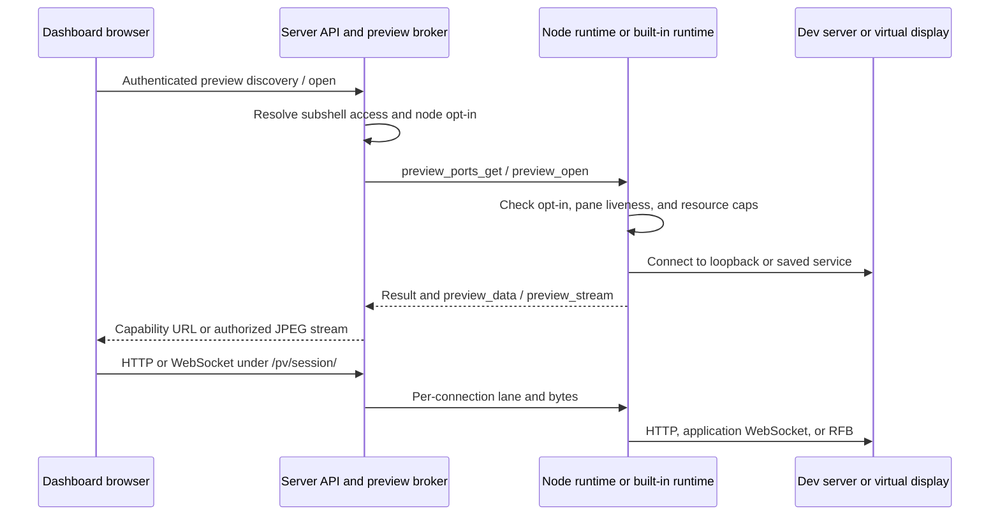

# Preview architecture

Preview connects a browser to a subshell's dev server, browser frames, or
virtual display through the server. The current implementation is shared by
enrolled nodes and the server's built-in node. User procedures live in the
[Preview guide](../apps/docs/content/docs/previews/index.mdx); the threat model
and audit findings live in [security §11.15](security.md#1115-web-previews-and-virtual-displays)
and [the preview audit](security-actionable.md#preview-feature-audit-2026-10-24).

Public developer guides explain [web preview architecture](../apps/docs/content/docs/developers/web-preview-architecture.mdx) and [how to develop and extend previews](../apps/docs/content/docs/developers/web-preview-development.mdx).

## Components and boundaries

The server owns authorization, capability references, cookie jars, lane queues,
stream audiences, and audit records. `services/preview-broker.ts` is its one
lifecycle owner. `preview/pv-http.ts` and `pv-ws.ts` translate browser traffic to
broker lanes rather than dialing node ports themselves.

For enrolled nodes, signed commands and preview frames travel inside the
established encrypted `/ws/node` connection. `services/nodes/preview-frames.ts`
binds incoming references to the authenticated node before dispatching them.
The built-in node calls `preview/local-preview.ts` in process. Both use
`packages/pane-runtime/src/preview/` for discovery, TCP forwarding, CDP, and
displays. A built-in preview does not need an enrolled daemon or a node socket.

## Discovery and launch

`GET /api/subshells/:id/views` requires view access and returns ports, the
first discovered CDP port, display metadata, and availability reasons. The
Linux runtime walks `/proc` from the subshell's tmux PID, joining descendant
socket inodes with listener tables. Bounded HTTP probes keep only ports that serve
HTML, excluding browser debugging and display listeners from the website list.
Probes try IPv4 loopback and then IPv6, in the order forwarding dials them. A
website is offered from the IPv6 answer only when IPv4 was refused, not when it
stalled: forwarding retries `::1` after a refused connect but not after a socket
that accepts and never answers, so advertising such a port would offer a preview
that can only hang. CDP probes and the screencast bridge, which dial loopback
themselves rather than through a lane, ask both families whenever the first gives
no usable answer, including well-formed JSON that is not a CDP response. The
bridge validates target rows before choosing one and resolves an advertised
`localhost` against the family that supplied that list, without a DNS lookup.
Same-port redirects are followed; cross-origin redirects and download responses
are excluded. A bounded document prefix supplies an optional page title for the
picker and truncated tab labels; SVG accessibility titles are excluded.
The broker caches answers for five seconds.
Discovery is a UI aid, not an allowlist for edit-authorized raw forwarding.

### Display providers and viewer protocols

Public developer guides cover [virtual display architecture](../apps/docs/content/docs/developers/virtual-display-architecture.mdx) and [implementing a provider](../apps/docs/content/docs/developers/virtual-display-provider.mdx), including a runnable Linux example.

`PreviewDisplays` applies the node permission and chooses a bundled
`VirtualDisplayProvider`. The node row stores an enabled set in
`virtual_display_providers` and a default in `virtual_display_provider`. Node
settings render a switch and prerequisites for each provider, plus **Default
display provider**. The signed `set_preview_enabled` command carries both as
`displayProviders` and `displayProvider`. Each launch may request an enabled
provider; omission resolves the node default once, before persistence. Changing
the default affects new subshells using that default. The runtime finds existing displays through
their owning provider and reconciles every registered provider after restart.
Unknown provider identifiers fail closed instead of falling back to Linux.

A provider implements readiness, allocation, public screen lookup, local launch
environment, loss reporting, cleanup, and recovery. Readiness may be asynchronous;
it describes the selected backend's programs or permissions. The requirements
list contains bounded strings, not a shared enum of Linux executable names.
The launchers consume `launchEnv()` without constructing X11 variables.
Those values stay on the machine and never enter the screen descriptor.
Providers are trusted, statically bundled code with the host process's privileges;
the interface is an extension boundary, not a sandbox.

The runtime orders opens and closes per subshell. A second provider cannot
allocate while the first is pending, and cleanup waits for allocation before
releasing resources. It rechecks the feature flag and enabled provider set
after asynchronous readiness and before allocation. Providers must bound their
waits, roll back partial allocations, and complete cleanup before its promise
resolves. Cleanup remains available when a provider is disabled.

`XvfbDisplayProvider` is the first backend. It creates private Xauthority files,
Xvfb with TCP disabled, and loopback x11vnc listeners. Its records live under
`display-providers/xvfb-x11vnc/displays/` in the data directory. It verifies
process identity before recovery or signalling and skips occupied X display
numbers. RFB ports are reserved before asynchronous probing so concurrent
launches cannot select the same candidate. Both X and RFB must answer before
allocation succeeds, and the RFB listener's socket inode must belong to the
spawned x11vnc PID on IPv4 loopback. Recovery repeats that ownership check;
a responding port alone is insufficient.

The public descriptor is `{ display, viewer: { protocol: "vnc", port } }`.
`display` is an opaque display identifier, not necessarily an X display number.
Only loopback connections and implemented viewer protocols are accepted. The
web client's `ScreenViewer` dispatches to `VncScreenViewer`; noVNC-specific
connection, input, and framebuffer handling lives in that adapter. The broker
uses the registered viewer port for raw forwarding and the existing permission
checks. Display lookup remains usable without Linux process-tree discovery.

To add a backend, implement `VirtualDisplayProvider`, give its records a private
provider namespace, add its factory to `createDisplayProviders`, and add its
label to `VIRTUAL_DISPLAY_PROVIDERS`. The registry test pins their agreement.
A backend exposing VNC reuses the existing viewer and authenticated transport.
Another protocol needs a validated connection descriptor and renderer/transport
support. These are statically bundled providers, not installable harness or
network plugins. `BetterDisplayProvider` adds macOS virtual screens with a
separately enabled native capture/input helper and a local RFB bridge. Both
desktop apps bundle the same helper. See [macOS helper architecture](macos-display-helper.md)
for consent, signing, ownership, recovery, and shared-desktop limitations. The
[BetterDisplay experiment](betterdisplay-experiment.md) records the original
prototype evidence; it is not a description of the production permission identity.
The [BetterDisplay integration protocol](../apps/docs/content/docs/developers/betterdisplay-protocol.mdx) specifies the helper messages and RFB subset.

Provider contract tests exercise a non-X11 backend, selection changes, readiness,
permission refusal, and cleanup while disabled. The Xvfb regression suite retains
its process ownership, rollback, recovery, and launch-environment checks.
Private Xauthority files authenticate X11 clients; they do not authenticate the
loopback RFB port. See the local-user limitation in the security model.

## Protocol 24

| Command or frame | Purpose |
| --- | --- |
| `set_preview_enabled { on, webPreviewsOn?, displayOn?, displayProvider, displayProviders, changedAt }` | Signed mirror of independent feature permissions, default provider, and allowed providers. Closing is separate. |
| `preview_display_check { provider? }` | Report prerequisites for the requested provider or node default without allocating. |
| `launch { screen?: { width, height, provider? }, ... }` | Allocate a display through an enabled provider; the server resolves and persists the provider before sending the launch. |
| `preview_ports_get { paneId }` | Discover the subshell's listeners, CDP port, and display. |
| `preview_open { ref, kind, paneId, port, lifetimeMs, fps?, service? }` | Open `forward` TCP bytes or a `screencast` CDP bridge. An optional `service: { host, protocol }` selects an explicit HTTP(S) destination for forward lanes only. |
| `preview_close { ref, reason }` | Release a lane or bridge; an unknown reference closes idempotently. |
| `preview_data { ref, dir, blob }` | Base64 TCP bytes; `in` goes toward the node and `out` toward the server. Ordering comes from the link. |
| `preview_stream` | JPEG frame with bridge reference, sequence, dimensions, and capture metadata. |
| `preview_closed` | Named termination reason, routed only from the reference's node. |

The shared grammar lives in `packages/subshell-protocol/src/node-frames.ts`;
limits live in `ssh-limits.ts`. Commands retain normal node audience,
expiration, signature, and replay checks. Established node traffic uses the
existing encrypted transport; preview is not a second listener exposed to the
viewer. The trusted server can read these bytes, unlike encrypted agent channels.

## Saved services

`GET/POST /api/subshells/:id/services` lists and saves destinations; `DELETE
/api/subshells/:id/services/:serviceId` removes one. SQLite stores up to 100 unique
host/port/protocol combinations per subshell, with cascading deletion. Read access
uses the subshell view gate; mutations require edit access. Machine credentials
retain the owner-only boundary. Saving never starts a process or dials a host.

Opening with `{ serviceId }` looks up the immutable destination under that subshell,
checks node opt-in and pane liveness, and forces HTTP mode. Every per-request lane
uses that same destination, including WebSockets. DNS and TLS run on the node;
TLS certificate and hostname checks stay enabled. Protocol 24 prevents older nodes
from silently ignoring a destination and falling back to plaintext loopback.

Removal cancels pending opens and revokes sessions for that saved ID; authorization
rechecks also check that it still exists. Closing a workspace tab preserves the
saved row. Workspace IDs carry the service ID and a display port, but only the
server-side row determines the dial destination. Port discovery and a Linux
virtual display are not prerequisites for manual HTTP(S) services.

## HTTP and WebSocket lanes

An edit-authorized `POST /api/subshells/:id/views/open` probes the node and
creates a session with a cryptographically random 128-bit reference. It returns
`/pv/<ref>/`. That path is a bearer capability; later proxy requests do not use
the viewer's browser cookie as their authorization boundary.

Toward the browser, TCP reads are split into frames within the existing wire
limit; a large read is not itself an oversized protocol message. Toward the
pane, a single write larger than the frame cap is refused by name and the lane
dies `over-cap`, the one lane-level audit row. The HTTP header reader pauses its
stream until the body or WebSocket reader takes over, preserving packets that
arrive during that handoff.

Each HTTP request uses a fresh lane. The server strips dashboard cookies,
HTTP authorization, API keys, and known edge-identity headers,
sets `Host` to the saved destination (loopback for automatic views), frames the HTTP request over the lane, and releases it
when the response completes or the browser aborts. It does not retry partial
writes. Personal proxy settings default to rewriting app URLs and redirects,
with preview-host forwarding off. Supported HTML attributes, CSS URLs/imports,
and module import specifiers are mapped under the session path. Next.js pages
also receive Turbopack’s chunk-base override before their first script, keeping
its chunk registry consistent with rewritten URLs. Replacing an active Turbopack
stylesheet adds a fresh `ts` parameter so Chromium does not reuse the old CSS
inside the opaque-origin frame. An injected
browser script handles common dynamic request and DOM URL APIs; target CSP can
block it. Text rewriting is bounded to 16 MiB decoded, while untransformed
bodies stream. Rewriting preserves the opaque-origin sandbox, so storage,
service workers, and arbitrary app behavior still need a normal browser context.
See [Configure an app preview](../apps/docs/content/docs/previews/apps.mdx#configure-an-app-preview)
for personal settings and their defaults.

Target `Set-Cookie` pairs remain in the session's server-side jar and are used
only on subsequent target requests. No target cookie is installed on the
dashboard origin. Origin-wide response policy headers (`Clear-Site-Data`,
`WWW-Authenticate`, HSTS, Alt-Svc, NEL, Report-To, Reporting-Endpoints,
Accept-CH, and Critical-CH) are removed. Target Content-Length is also removed;
the proxy owns browser response framing. Custom reverse-proxy identity
headers outside the recognized families need operator filtering.
Name-only cookie keying is a compatibility limitation, not
a full browser cookie implementation. Jars evict oldest entries to stay within
128 cookies and 64 KiB; individual cookies over 4 KiB are ignored.

Every proxied response enforces a CSP sandbox without `allow-same-origin`.
The workspace iframe adds the same sandbox attribute so a navigation cannot
remove the embedding boundary. Scripts and forms work in an opaque origin;
preview-specific CORS allows modules and fetches under the capability URL.
Opaque `Origin: null` is admitted only to preview HTTP preflight and preview
WebSocket handshakes. Dashboard API and WebSocket gates still reject it.
Document navigations are judged by what the phone does with the answer, not by
whether it is a web page. A response the browser presents itself stays: a document,
a chunk of text, an image, an audio or video clip, or JSON and XML rendered as text.
What is answered with an inline
error page is a file the server hands over (an `attachment`, whatever its type
claims) or a binary the view cannot read, because on iOS that hand-off takes the
whole presentation with no way back. A desktop browser downloads in its own UI and
leaves the preview alone, so the same bytes go through there: the refusal is scoped
to the clients that can be stranded. It covers only responses served through the
preview capability; external redirects are not fetched or inspected by the proxy. A page that declares no type at all is left to
the browser, which renders it as text. Subresource and fetch
responses retain their content types either way, and the cookies a refused response
carried still enter the session jar, so the app is not quietly signed out by the
refusal.

The refusal page also announces itself to the dashboard, which shows a toast so the
person learns what happened where they were looking. The page runs in the same
opaque-origin sandbox, so its `event.origin` reads `null` and proves nothing: the
panel believes a message only when it comes from the window of the frame that panel
created and names that session's own ref. This is untrusted status: app scripts
in that same frame know the ref and can send an identical message. The words shown
are fixed copy chosen from two known values, and a mounted panel emits at most one
notification per capability/reload. No message grants access or runs an action.
The parent checks the source window; it does not add `null` to an origin allowlist.

Discovery and the guard ask the same question from one place, and the rewriter
answers it slightly differently: a document served as `application/xhtml+xml` is
listed, navigated and rewritten, but its injected script goes in as a CDATA section,
because that document is parsed as strict XML where a raw `<` is a fatal error
rather than JavaScript.

Responses use `no-store` and `no-referrer`; request logging excludes `/pv/` paths.

A WebSocket upgrade allocates a lane before accepting the browser. HTTP-mode
sessions perform a real upstream upgrade with their own cookie jar. Raw-mode
sessions are reserved for the subshell's reported RFB port and pump bytes
straight to noVNC. Error and queue teardown share one owner and stable close
reasons. The HTTP-mode WS parser preserves message meaning but can reserialize
JSON-looking text; it does not promise byte-identical application WS text.

## Browser watches and lifetime

A watch requires view access. View-only grantees can watch only the CDP port
reported for their shared subshell; supplying another port is refused before
the bridge opens. Owners and edit grantees can supply a port explicitly, as
they already have shell-equivalent access. CDP discovery refuses non-loopback
WebSocket targets returned by the browser and requires the requested port.
CDP HTTP discovery refuses redirects, bounds JSON at 256 KiB, and aborts on
handshake timeout or cancellation. Pending handshakes count toward node capacity.

The runtime starts `Page.startScreencast`, acknowledges incoming frames, and
emits bounded JPEGs. The server fans them out through an explicitly authorized
`/ws/live` watch subscription. A static page does not expire because it stops
repainting. Unwatching releases that viewer; the bridge closes after its last
viewer leaves. Grant changes, account disable, subshell death, and node loss
close or prune the affected sessions and subscriptions. Explicit terminate,
delete, and restart await broker teardown before stopping the old process;
revocation does not depend on an exit hook arriving after token rotation.
Pending opens participate in every revocation sweep, then recheck current
account/access and pane/node availability before publishing a session. A second
sweep after retiring the old row catches opens arriving during its stop.
Open and live-screen subscription checks carry a revocation revision: a permission
read overtaken by a sweep must be repeated before registration. Account disable
and required password changes are checked again at subscription time. Uncertain
open replies trigger best-effort teardown of the allocated node reference. A
watch publication also repeats the view-only port restriction if edit access
was downgraded while opening.

Forward sessions expire after 15 minutes without traffic. Each underlying
lane or bridge has a maximum four-hour lifetime. Closing an app tab releases
its browser connections; its bearer session can remain until idle expiry.
Switching Preview off prevents new operations; it is not an emergency drain
of existing connections or a stop command for graphical programs.

| Budget | Current bound |
| --- | --- |
| Raw payload per preview frame | 256 KiB |
| Buffered lane bytes, target TCP write queue, HTTP reader queue, and browser WS debt | 1 MiB each |
| Assembled application WS message | 1 MiB, including fragmented messages |
| Preview contribution to the encrypted link's send buffer | 1 MiB, checked before sealing |
| CDP discovery JSON | 256 KiB |
| Image/framebuffer dimensions | 8,192 per axis and 16,777,216 pixels |
| Encoded RFB JPEG/PNG | 4 MiB, with header dimensions matching the rectangle |
| RFB pending rendering | Next rectangle must fit within 33,554,432 queued pixels; refuse at 1,024 pending actions |
| RFB clipboard input | 1 MiB, consumed without decompression or clipboard integration |
| Retained forwarding capabilities per node | 64 |
| Pending preview opens per node | 32 |
| Cached discovery entries | 512 |
| Target cookie jar | 128 entries, 64 KiB total, 4 KiB per cookie |
| Active forward lanes per subshell | 4 |
| Active lanes and bridges per node | 16 |
| Waiting lanes per subshell | 8 |
| Watch subscribers | 8 |
| Watch frame rate | 1–5 fps, default 5 |
| Buffered screencast frames | 5 |
| Stream subscriber byte debt | 4 MiB |

The browser checks JPEG/PNG dimensions before handing compressed bytes to its
image decoder. noVNC's optional H.264 path and animated PNGs are refused;
x11vnc does not require them. The bounds adapter uses the pinned noVNC 1.7
private surface and has real-class regressions. A package upgrade must keep
those guards effective. Display cleanup and restart recovery verify each
saved PID's executable and Xauthority argument before trusting the child.

## Workspace presentation

Every app port, browser watch, and display has a separate dock panel identity:
`preview:<paneId>:app:<port>`, `preview:<paneId>:browser`, or
`preview:<paneId>:screen`. The shared parser validates these identities.
Server-side layout pruning reconstructs parameters from the identity and
retains panels only for authorized, surviving parent panes; saved parameters
cannot repoint a preview at another subshell.

New desktop previews split to the right of their terminal. Reopening the same
resource focuses it. Tabs remain movable; maximize and browser fullscreen enter
through the viewer menu and expose their restore controls directly while active.
Hidden viewers release connections, and showing them reopens their resource.
The phone presentation keeps a flat local tab strip and never overwrites the
desktop split layout.

## Verification

- API proxy, broker, grants, origin, and layout tests cover server boundaries.
- Node tests exercise display allocation, argv, cleanup, discovery, CDP target
  validation, and byte limits without launching fake graphical programs.
- `e2e/tests/48-preview-browser-isolation.spec.ts` checks embedded and direct
  browser isolation and immediate URL revocation after deletion in CI.
- `bun e2e/capture-preview-demo.ts --security-only` boots a disposable stack and
  uses Chromium to verify opaque origins, blocked dashboard access, and working
  module loading, JSON POST, and WebSocket traffic in embedded and direct views.
- `bun e2e/capture-preview-demo.ts` additionally records a real agent fixing a
  sample website, checks the result in Preview, and captures documentation images.

## MCP entry points

The shared MCP server wraps the existing REST gates: `list_subshell_views`,
`open_subshell_view`, and `watch_subshell_browser` use subshell preview routes;
`create_subshell.screen` passes display dimensions and an optional provider to the
normal launch route. Omitting `screen` inherits a preset request; `null` opts out.
`exec_in_terminal` starts programs in the helper's inherited display environment.
There is no separate MCP transport or authorization bypass, and these calls
neither install prerequisites nor enable Preview nor mutate workspace tabs.

`list_nodes` includes harness health, daemon protocol/version/hold, and SSH and
Preview settings. `get_node` resolves through that same owner-only list and
optionally calls display preflight. Only this read-only node preflight route
additionally accepts subshell tokens, with `loadNodeGate` enforcing owned
enrolled nodes. Node detail/configuration and SSH retain their existing guards.
`get_node.provider` selects which provider to probe. Its `virtualDisplay.enabled`
combines the node flag and provider membership, separately from prerequisite
`status`. Readiness distinguishes unknown/unavailable from unsupported or missing
programs; a successful probe does not guarantee permission or launch success.

`open_subshell_view` returns a secret relative capability path. App paths carry HTTP;
display paths carry RFB over WebSocket, not an HTML viewer. `watch_subshell_browser` frames
remain on authorized live subscriptions rather than MCP tool responses.

## Naming and compatibility

The dashboard calls the feature **Web previews & screens**. Public REST resources use
`views`: discovery at `GET /api/subshells/:id/views`, opening at
`POST /api/subshells/:id/views/open`, and browser-watch interest at
`POST` or `DELETE /api/subshells/:id/views/browser/watch`. Node configuration
uses `PUT /api/nodes/:id/views-enabled`; node responses expose `webPreviewsEnabled`.
Display prerequisites are `GET /api/nodes/:id/display-readiness`, requested by
MCP `get_node` with the optional `check_display` argument.

The original public preview endpoints and MCP tools were introduced on this
unreleased branch, so they are renamed directly without duplicate aliases.
The permission id `nodes:preview`, database timestamp columns, audit
identifiers, signed node commands/frames, `/pv/` capability paths, and persisted
`preview:` workspace panel ids keep their existing spelling. Those names carry
stored state or transport compatibility; the web-preview permission uses `webPreviewsEnabled` in both the database model and API. Virtual displays use the independent `virtualDisplayEnabled`
column and node-view field. The existing `/views-enabled` write accepts
`feature: "web-previews" | "display"` (omitted means web previews), with the same ownership gate.
The signed mirror's `on` is the transport allowance (either feature enabled);
`webPreviewsOn` and `displayOn` narrow it when the permissions differ. Legacy mirrors
without those fields retain the combined meaning, and reconciliation compares
both permissions. Launching a screen checks the display permission, while app
and browser opens check the web-preview permission. These aren't alternative public discovery endpoints. The
subshell `preview` field still means its recent terminal output, and website
previews remain a useful description of the app viewer.

## Saved display choices and launch forms

Virtual-display dimensions and the resolved provider are retained in `subshells.screenConfig`. `nodes.virtualDisplayProviders` stores the enabled set; `virtualDisplayProvider` names its default. The signed mirror carries both. A launch can request any enabled provider; omission resolves the default once, before persistence. Manual and automatic restarts retain the saved provider and recheck policy. A manual restart refuses before stopping the existing pane if the feature or provider is disabled. Presets store an optional display request in `screenConfig`; an explicit null on creation overrides that preset without a display. Readiness accepts an optional provider ID and never allocates resources.

Changing nodes in the launch form reconciles the directory and harness against
the selected node. An unavailable harness and its copied preset selection are
cleared; the form does not silently choose a replacement agent. A confirmed
unavailable display is unchecked and explained inside the Virtual display
section. Pending or failed probes preserve the selection and block launch;
late results from another node or provider cannot change the current form.
Explicitly applying a preset retains its display intent for the user to resolve.
See [launch-form guidance](../apps/server/web/docs/home-launch-guidance.md).

Forward lanes buffer target greetings until the proxy subscribes, bounded by the lane byte budget and 256 chunks. A subscriber attaching after its lane closed receives an immediate closed event.
