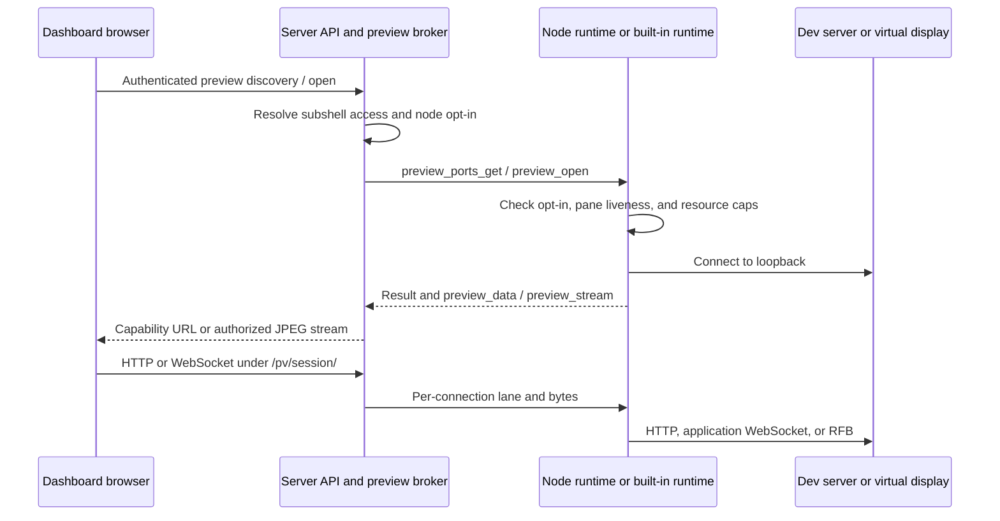

# Preview architecture

Preview connects a browser to a subshell's dev server, browser frames, or
virtual display through the server. The current implementation is shared by
enrolled nodes and the server's built-in node. User procedures live in the
[Preview guide](../apps/docs/content/docs/guides/preview.mdx); the threat model
and audit findings live in [security §11.15](security.md#1115-preview-apps-browsers-and-virtual-displays)
and [the preview audit](security-actionable.md#preview-feature-audit-2026-10-24).

## Components and boundaries

The server owns authorization, capability references, cookie jars, lane queues,
stream audiences, and audit records. `services/preview-broker.ts` is its one
lifecycle owner. `preview/pv-http.ts` and `pv-ws.ts` translate browser traffic to
broker lanes rather than dialing node ports themselves.

For enrolled nodes, signed commands and preview frames travel inside the
established encrypted `/ws/node` connection. `services/nodes/preview-frames.ts`
binds incoming references to the authenticated node before dispatching them.
The built-in node calls `preview/local-preview.ts` in process. Both use
`packages/pane-runtime/src/preview/` for discovery, TCP forwarding, CDP, and
displays. A built-in preview does not need an enrolled daemon or a node socket.

## Discovery and launch

`GET /api/subshells/:id/preview` requires view access and returns ports, the
first discovered CDP port, display metadata, and availability reasons. The
Linux runtime walks `/proc` from the subshell's tmux PID, joining descendant
socket inodes with listener tables. The broker caches answers for five seconds.
Discovery is a UI aid, not an allowlist for edit-authorized raw forwarding.

Display preflight is separate: `GET /api/nodes/:id/preview-display` checks Linux
support, Preview opt-in, and Xvfb, x11vnc, and xauth without launching anything.
Launch checks again. Each display gets an Xauthority file, Xvfb with TCP disabled,
and a loopback x11vnc listener. The allocator skips host X sockets and lock files
as well as its own data-directory locks. Readiness must observe both X and RFB.

The launcher supplies `DISPLAY` and `XAUTHORITY` to the subshell. Agents and GUI
programs started there inherit them. Display metadata persists beside the node
or server data, and startup/liveness reconciliation restores or removes it.
Private Xauthority files authenticate X11 clients; they do not authenticate the
loopback RFB port. See the local-user limitation in the security model.

## Protocol 23

| Command or frame | Purpose |
| --- | --- |
| `set_preview_enabled { on, changedAt }` | Signed mirror of the server's node opt-in. Closing is separate. |
| `preview_display_check` | Report platform and display prerequisites before a subshell exists. |
| `preview_ports_get { paneId }` | Discover the subshell's listeners, CDP port, and display. |
| `preview_open { ref, kind, paneId, port, lifetimeMs, fps? }` | Open `forward` TCP bytes or a `screencast` CDP bridge. There is no host field. |
| `preview_close { ref, reason }` | Release a lane or bridge; an unknown reference closes idempotently. |
| `preview_data { ref, dir, blob }` | Base64 TCP bytes; `in` goes toward the node and `out` toward the server. Ordering comes from the link. |
| `preview_stream` | JPEG frame with bridge reference, sequence, dimensions, and capture metadata. |
| `preview_closed` | Named termination reason, routed only from the reference's node. |

The shared grammar lives in `packages/subshell-protocol/src/node-frames.ts`;
limits live in `ssh-limits.ts`. Commands retain normal node audience,
expiration, signature, and replay checks. Established node traffic uses the
existing encrypted transport; preview is not a second listener exposed to the
viewer. The trusted server can read these bytes, unlike encrypted agent channels.

## HTTP and WebSocket lanes

An edit-authorized `POST /api/subshells/:id/preview/open` probes the node and
creates a session with a cryptographically random 128-bit reference. It returns
`/pv/<ref>/`. That path is a bearer capability; later proxy requests do not use
the viewer's browser cookie as their authorization boundary.

Each HTTP request uses a fresh lane. The server strips dashboard cookies,
HTTP authorization, API keys, and known edge-identity headers,
sets `Host` to loopback, frames the HTTP request over the lane, and releases it
when the response completes or the browser aborts. It does not retry partial
writes. Root-relative redirects are prefixed with the session path; HTML and
JavaScript asset URLs are not rewritten.

Target `Set-Cookie` pairs remain in the session's server-side jar and are used
only on subsequent target requests. No target cookie is installed on the
dashboard origin. Origin-wide response policy headers (`Clear-Site-Data`,
`WWW-Authenticate`, HSTS, Alt-Svc, NEL, Report-To, Reporting-Endpoints,
Accept-CH, and Critical-CH) are removed. Target Content-Length is also removed;
the proxy owns browser response framing. Custom reverse-proxy identity
headers outside the recognized families need operator filtering.
Name-only cookie keying is a compatibility limitation, not
a full browser cookie implementation. Jars evict oldest entries to stay within
128 cookies and 64 KiB; individual cookies over 4 KiB are ignored.

Every proxied response enforces a CSP sandbox without `allow-same-origin`.
The workspace iframe adds the same sandbox attribute so a navigation cannot
remove the embedding boundary. Scripts and forms work in an opaque origin;
preview-specific CORS allows modules and fetches under the capability URL.
Opaque `Origin: null` is admitted only to preview HTTP preflight and preview
WebSocket handshakes. Dashboard API and WebSocket gates still reject it.
Responses use `no-store` and `no-referrer`; request logging excludes `/pv/` paths.

A WebSocket upgrade allocates a lane before accepting the browser. HTTP-mode
sessions perform a real upstream upgrade with their own cookie jar. Raw-mode
sessions are reserved for the subshell's reported RFB port and pump bytes
straight to noVNC. Error and queue teardown share one owner and stable close
reasons. The HTTP-mode WS parser preserves message meaning but can reserialize
JSON-looking text; it does not promise byte-identical application WS text.

## Browser watches and lifetime

A watch requires view access. View-only grantees can watch only the CDP port
reported for their shared subshell; supplying another port is refused before
the bridge opens. Owners and edit grantees can supply a port explicitly, as
they already have shell-equivalent access. CDP discovery refuses non-loopback
WebSocket targets returned by the browser and requires the requested port.
CDP HTTP discovery refuses redirects, bounds JSON at 256 KiB, and aborts on
handshake timeout or cancellation. Pending handshakes count toward node capacity.

The runtime starts `Page.startScreencast`, acknowledges incoming frames, and
emits bounded JPEGs. The server fans them out through an explicitly authorized
`/ws/live` watch subscription. A static page does not expire because it stops
repainting. Unwatching releases that viewer; the bridge closes after its last
viewer leaves. Grant changes, account disable, subshell death, and node loss
close or prune the affected sessions and subscriptions. Explicit terminate,
delete, and restart await broker teardown before stopping the old process;
revocation does not depend on an exit hook arriving after token rotation.
Pending opens participate in every revocation sweep, then recheck current
account/access and pane/node availability before publishing a session. A second
sweep after retiring the old row catches opens arriving during its stop.
Live-screen subscription checks also carry a revocation revision: a permission
read overtaken by a sweep must be repeated before registration. Account disable
and required password changes are checked again at subscription time. Uncertain
open replies trigger best-effort teardown of the allocated node reference.

Forward sessions expire after 15 minutes without traffic. Each underlying
lane or bridge has a maximum four-hour lifetime. Closing an app tab releases
its browser connections; its bearer session can remain until idle expiry.
Switching Preview off prevents new operations; it is not an emergency drain
of existing connections or a stop command for graphical programs.

| Budget | Current bound |
| --- | --- |
| Raw payload per preview frame | 256 KiB |
| Buffered lane bytes, target TCP write queue, HTTP reader queue, and browser WS debt | 1 MiB each |
| Assembled application WS message | 1 MiB, including fragmented messages |
| CDP discovery JSON | 256 KiB |
| Target cookie jar | 128 entries, 64 KiB total, 4 KiB per cookie |
| Active forward lanes per subshell | 4 |
| Active lanes and bridges per node | 16 |
| Waiting lanes per subshell | 8 |
| Watch subscribers | 8 |
| Watch frame rate | 1–5 fps, default 5 |
| Buffered screencast frames | 5 |
| Stream subscriber byte debt | 4 MiB |

## Workspace presentation

Every app port, browser watch, and display has a separate dock panel identity:
`preview:<paneId>:app:<port>`, `preview:<paneId>:browser`, or
`preview:<paneId>:screen`. The shared parser validates these identities.
Server-side layout pruning reconstructs parameters from the identity and
retains panels only for authorized, surviving parent panes; saved parameters
cannot repoint a preview at another subshell.

New desktop previews split to the right of their terminal. Reopening the same
resource focuses it. Tabs remain movable; maximize and browser fullscreen enter
through the viewer menu and expose their restore controls directly while active.
Hidden viewers release connections, and showing them reopens their resource.
The phone presentation keeps a flat local tab strip and never overwrites the
desktop split layout.

## Verification

- API proxy, broker, grants, origin, and layout tests cover server boundaries.
- Node tests exercise display allocation, argv, cleanup, discovery, CDP target
  validation, and byte limits without launching fake graphical programs.
- `e2e/tests/48-preview-browser-isolation.spec.ts` checks embedded and direct
  browser isolation and immediate URL revocation after deletion in CI.
- `bun e2e/capture-preview-demo.ts --security-only` boots a disposable stack and
  uses Chromium to verify opaque origins, blocked dashboard access, and working
  module loading, JSON POST, and WebSocket traffic in embedded and direct views.
- `bun e2e/capture-preview-demo.ts` additionally records a real agent fixing a
  sample website, checks the result in Preview, and captures documentation images.
